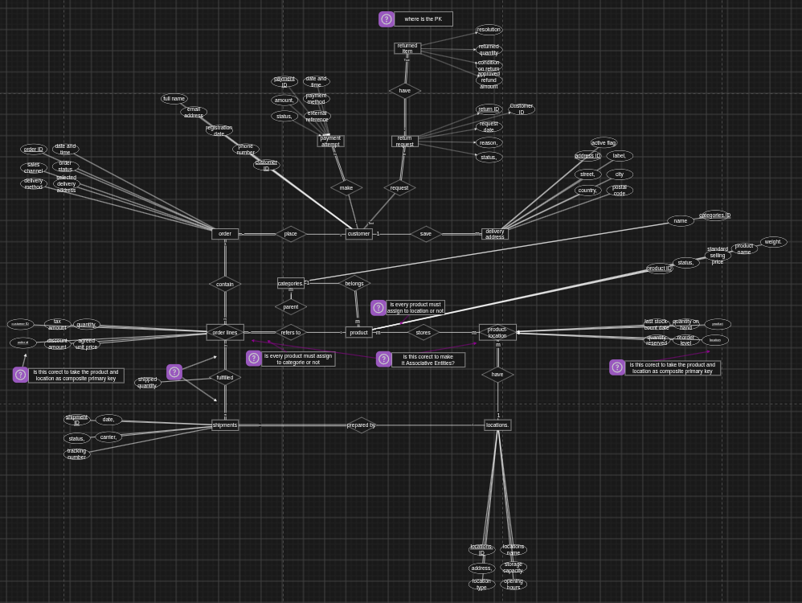

# Lab 2

### ● Create a new project on your local machine, then push it your remote repo.

```bash
$mkdir VCS_Lab2$ cd VCS_Lab2
$git init$ git remote add origin git@github.com:Abdullah-MLE/ITI_VCS_Course_Lab2.git
$ touch file1
$git add .$ git commit -m "first_commit"
```

---

### ● Create two branches (dev & test) then create one file on each branch, and push this changes to the remote repo.

```bash
$ git switch -c dev
$git add .$ git commit -m "2'nd_commit_test"

$ git switch -c test
$git add .$ git commit -m "3'rd_commit_dev"

$git push origin dev$ git push origin test
```

---

### ● Merge this changes on Main branch and then push it to your remote main branch.

```bash
$ git switch dev
$git merge test$ git switch main
$git merge dev$ git push
```

---

### ● Tell me how to remove them locally and remotely.
- Tell me how to remove them locally and remotely?

```bash
$git branch -d test$ git branch -d dev

$git push origin --delete test$ git push origin --delete dev
```

---

### ● Tell me how to checkout another branch without commit changes
- Tell me how to checkout another branch without commit changes?

```bash
$git stash$ git stash pop
```

---

### ● Create an annotated tag with tagname (v1.7) .
### ● Push it to the remote repository.

```bash
$ git tag -a "v1.7" -m "version 1"
$ git push origin tag v1.7
```

---

### ● Tell me how to list tags.
- list tags?

```bash
$ git tag -l
```

---

### ● Tell me how to delete tag locally and remotely.

```bash
$git tag -d v1.7$ git push -d origin v1.7
```

---

### ● Add an image in the README.md file.
- add image in the md

```markdown
- 
```


